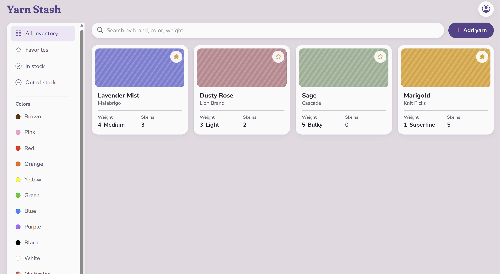

# Yarn Stash

A web app for knitters and crocheters to manage their yarn inventory: what they have, how much is left, and which colors they love.

**[Try the live demo](https://emmagl421.github.io/Crochet-project/)** (click "Try the demo", no account needed)

## Features

- **Personal stash:** add and edit yarn with brand, color name, weight, skein count, and an exact color picked with a color picker
- **Filtering:** view all yarn, favorites, in stock, or out of stock, and filter by color category
- **Live search:** search by brand, color name, weight, or category as you type
- **Favorites:** star yarn to save it to a favorites view
- - **Accounts:** email and password sign up and log in with Supabase Auth, plus editing your name, email, or password. Public sign-up is hidden on the live site so visitors use the demo; the code is in `signup.html` and `login.html`.
- **Demo mode:** visitors can try the app instantly in their own private sandbox, preloaded with sample yarn
- **Responsive design:** works on desktop and mobile

## Tech Stack

- **Front end:** HTML, CSS, JavaScript, jQuery, Bootstrap 5
- **Back end:** Supabase (PostgreSQL database and authentication)
- **Hosting:** GitHub Pages

## Security

- **Row Level Security:** database policies ensure each user can only read and change their own yarn, enforced by the database rather than the front end
- **Isolated demo accounts:** each demo visitor gets an anonymous account with its own data, so visitors can't see or change each other's yarn
- **Safe rendering:** user input is displayed with jQuery's `.text()`, which prevents HTML or script injection
- **No secrets in the code:** only Supabase's public key is in the front end; passwords are handled and hashed by Supabase

## What I Learned

- Designing a database table and writing Row Level Security policies in SQL so users' data stays private
- Handling sign up, log in, and anonymous sessions with Supabase Auth
- Building search and filters that combine into a single database query
- Updating the page dynamically with jQuery, including optimistic updates for favorites that roll back if saving fails
- Writing form validation with clear, accessible error messages

## Future Improvements

- Delete yarn from your stash
- Password reset by email
- Track yarn by project

## Running Locally

**Requires:** Node.js

1. Clone the repo
2. In the project folder, run `npx serve`
3. Open the address it prints (usually `http://localhost:3000`)

## Author 

Emma Leonard: [LinkedIn](https://www.linkedin.com/in/emma-leonard2005/)

## Diary ------------------------------
### 10/20/2026 --------
I know READMEs don't normally have this but because this is a personal project I thought it would be useful to share my thinking. I started this project trying not to use AI much. I figured out that that is not really useful. However, I don't just want to vibe code my way through this. I love backend so I will most likey do more work there and leave the front end to AI from now on. 

So what is this project? A little background, I love to crochet but, I buy a LOT of yarn. The problem is I have so much that I buy the same yarn I already have without knowing. The goal of this site is to fix that. 

What am I doing now? I am letting Claude (my beloved) work on the front end and make it look more professional. The goal is to take that, tailor it if needed, attach a script to it for functionality, set up the server side, and set up the Supabase connection. 

### 10/21/2026 --------
Ok so, I have used AI to help me set up the sign in/login process. I had to make sure passwords were being safely stored and (lucky) Supabase already does that. 

I just finished the sign up/login part and can now start on the functionality of the page. I actaully enjoyed the process and found it interesting. I didn't know of all the cases that go into this process. 

I will need more help from AI for how to do calls to the database to get, update, delete, and post data. I will also need to hook up email confirmation but that is a later task, after I am ready to launch it. 

Current To-do -
- functionality for adding yarn to the db (need a service call)
- functionality for the different views (might need to add table row for that)
- functionality for editing yarn via clicking the card (need service call)

### 10/22/2026 --------
So turns I still have work to do for the login so I am doing that now. I'm also learning that with Supabase, I don't need a lot of what I was thinking I did.

The goal right now is to finish up the login/sign in handling. Then maybe I can work on other functionality. 

I also want to ask the crochet club if I could send a survey/come talk in person to get data on features they would find useful. This is to (hopefully) include some HCI into this. So, I must add it to the todo list.

Current To-do -
- finish login/sign up
- Reach out to the crochet club for input 
- functionality for adding yarn to the db (need a service call)
- functionality for the different views (might need to add table row for that)
- functionality for editing yarn via clicking the card (need service call)

### 10/26/2026 --------
I did a hackathon over the weeekend so now I am back working on this. 

Claude (my beloved) walked me through the finsihed script and I typed it by hand to catch any errors that 
could be there. 

There are a few things I want to add. Like a view selector for the color categories. Making it seperate from the search does two things: 
1) Allows for faster and easier search for any color in a category (initial reason)
2) Some color names given by brands might not match with the category the user puts it in (So searching a category (i.e. Red) will show color names as well)

Current To-do -
- Reach out to the crochet club for input 
- Functionality for editing yarn via clicking the card (need service call)
- Color category views 

### 10/28/2026
I reached out to the crochet club and am waiting for a response.

I also checked off everything on my current todo list and added the abibilty to edit account infomation.  

Right now I am trying to set up email confirmation and deciding if I want to host this on GitHub pages or on my own domain. 
I am currently making sure everything is safely set up and handled throughout Supabase, Claude, and GitHub so that there is no infomation leak.

Ok, I found a solution: I am going to make this a demo site. It's just a fun personal project and I have learned a lot from it. I really don't feel comfortable handling emails and passwords. So this will just be a demo/proof of concept site. I will keep the code for the login/signup but I won't use it.

## 10/29/2026
Ok I think this is almost done so I will try and finish it today. After I finish it I will post it to GitHub pages. 

I haven't gotten a response from the crochet club but I will make the survey anyway and hope they respond.

Ok I just finished the project!!!!! Now it is time push it to GitHub pages and it'll be all done!!

Now I will just wait to see if the crochet club response and make changes from there. 

Current To-do -
- Make survey 

